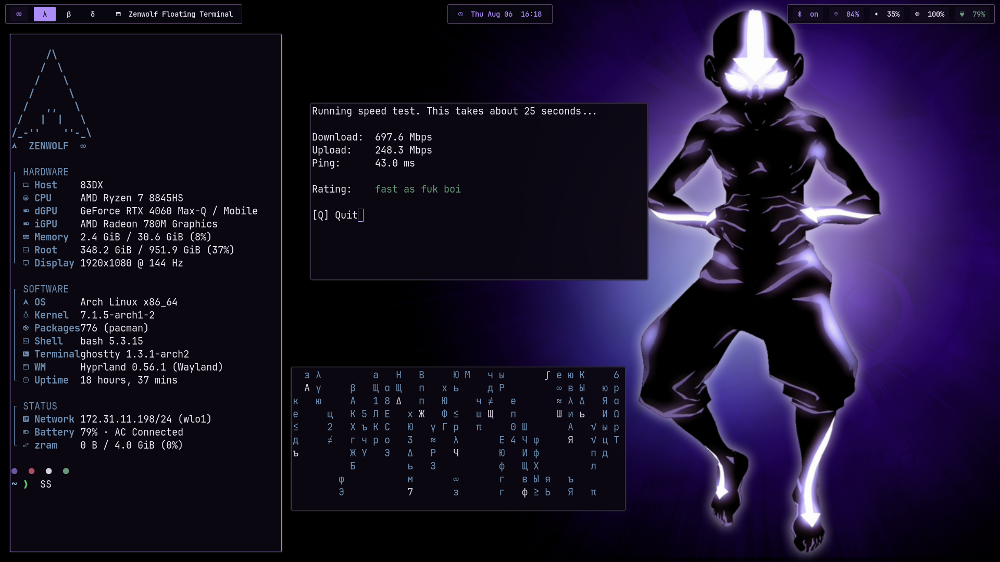
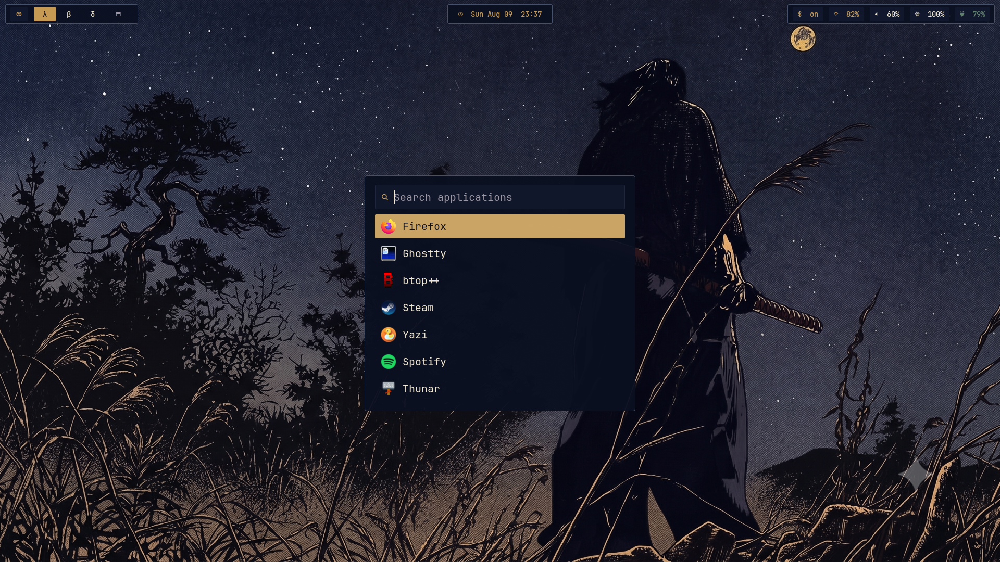
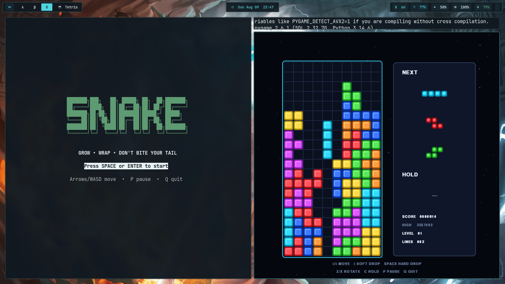
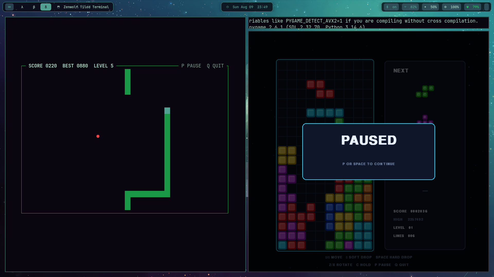
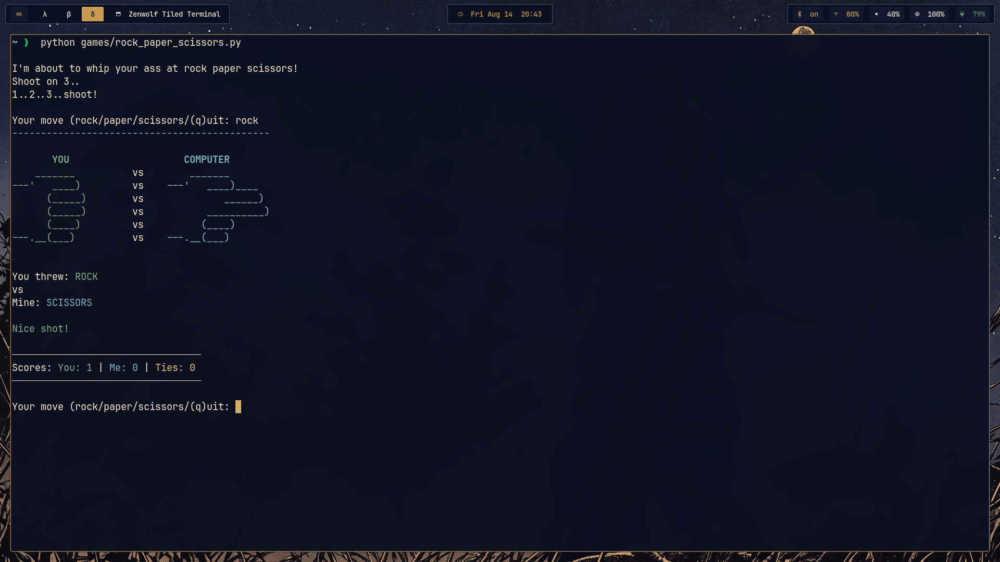

# Zenwolf dotfiles

Zenwolf is a keyboard-first Arch and Hyprland desktop. Nine coordinated
themes, a visual wallpaper picker, floating and tiled workspaces, a deliberate
hybrid-GPU gaming lifecycle, and a bunch of small quality-of-life details.

Browse around and copy whatever you find useful. You don't need to adopt the
entire setup.



[Watch the 55-second Zenwolf tour](assets/videos/01-zenwolf-tour.mp4)

## Start here

- [`home/`](home/) maps the user configuration below your home directory.
- [`games/`](games/) contains five standalone Python games.
- [`docs/build-guide.md`](docs/build-guide.md) is the original Arch build guide.
- [`docs/kali-vmware-apple-silicon.md`](docs/kali-vmware-apple-silicon.md) is an instructions-only starting point for Kali ARM64 in VMware Fusion on Apple silicon.
- [`docs/cheatsheet.md`](docs/cheatsheet.md) collects the shortcuts and everyday commands.

The complete desktop and hardware layer were built for Arch, with an AMD display GPU and optional NVIDIA GPU. The Kali guide does not convert the Arch system modules and calls out the limits of a virtual graphics device; treat Hyprland in a VM as experimental. If you only want a theme, script, or Rofi layout, take that piece and make it yours.



## Install and run

For the original Arch setup, follow the [build guide](docs/build-guide.md). For Kali Linux on an Apple-silicon Mac, use the [VMware Fusion notes](docs/kali-vmware-apple-silicon.md) and check the Kali package versions before deploying compositor configuration.

Clone this fork and preview the home-directory deployment:

```bash
git clone --branch kali-vmware-m4 https://github.com/heikojan2010/zenwolf-dotfiles.git
cd zenwolf-dotfiles
rsync -avni home/ "$HOME/"
```

Before deploying `home/`, review the hardware and compatibility notes for your platform. Then copy without deleting unrelated files, install the wallpapers, and start with one coordinated theme:

```bash
rsync -avi home/ "$HOME/"
install -d -m 755 ~/.local/share/zenwolf/wallpapers
install -m 644 assets/wallpapers/* ~/.local/share/zenwolf/wallpapers/
xdg-user-dirs-update
update-desktop-database ~/.local/share/applications
systemctl --user daemon-reload
export PATH="$HOME/.local/bin:$PATH"
zenwolf-theme-build check
zenwolf-theme elements
```

Only run `start-zenwolf-desktop` after confirming the installed Hyprland version supports this repository's Lua configuration and that the VM graphics session works. Do not install the upstream Arch GPU/system modules in Kali.

## Games

The five small games can run independently of the desktop:

```bash
python3 games/number_guessing_game.py
python3 games/rock_paper_scissors.py
python3 games/snake.py
python3 games/tetris.py
python3 games/tetris_pygame.py
```

<p align="center">
  
  
</p>

<p align="center">
  
</p>

## Credits

Zenwolf pulled ideas and inspiration from some really cool dotfile repos:

- [LierB/dotfiles](https://github.com/LierB/dotfiles)
- [maxhu08/dotfiles-old](https://github.com/maxhu08/dotfiles-old)
- [dilanrojas/dotfiles](https://github.com/dilanrojas/dotfiles)
- [Frewacom/pywalfox](https://github.com/Frewacom/pywalfox)
- [binnewbs/arch-hyprland](https://github.com/binnewbs/arch-hyprland)
- [x0d7x/dot](https://github.com/x0d7x/dot)
- [naveen-og/gilded-noir](https://github.com/naveen-og/gilded-noir)
